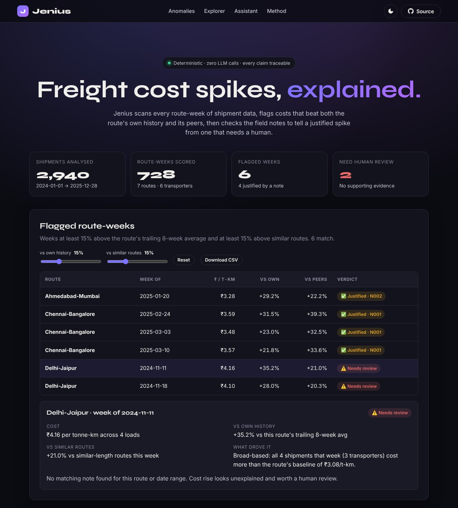
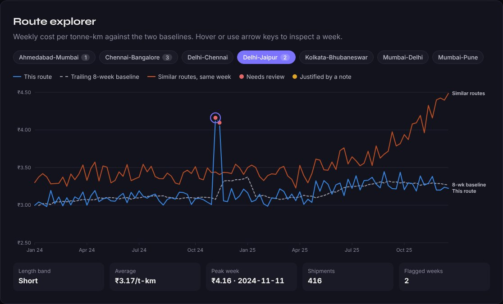
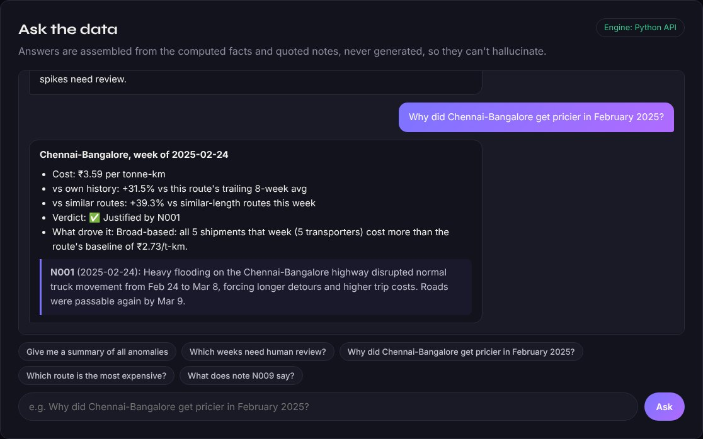
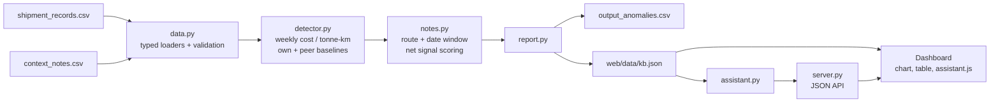

<div align="center">

# Jenius

**Freight cost spikes, explained.** Deterministic anomaly detection over shipment data, with a grounded assistant that can't hallucinate.

[](https://github.com/TheRealJahaan/Jenius-AI-Assistant/actions/workflows/ci.yml)


[](LICENSE)

[**Live demo**](https://therealjahaan.github.io/Jenius-AI-Assistant/) · [How it works](#how-it-works) · [Run locally](#quick-start) · [Deploy](#deploy) · [API](#http-api)



</div>

## What it does

A logistics team ships thousands of loads a year. Some weeks a route suddenly costs more. Is it a flood, a festival surcharge, or something nobody can explain that a human should chase?

Jenius answers that from two CSV files, `shipment_records.csv` (2,940 shipments, 7 routes, 2024-2025) and `context_notes.csv` (10 free-text field notes):

1. **Detects** route-weeks whose cost per tonne-km beats **both** the route's own trailing history **and** its peers that same week.
2. **Explains** each one by matching it to a field note, or escalates it for human review when no note genuinely justifies a rise.
3. **Shows** the result in an interactive dashboard: live threshold sliders, a route explorer chart and a Q&A assistant, deployable as a static site or a zero-dependency Python service.

On the bundled data it flags **6 route-weeks: 4 justified** (a festival surcharge and a highway flood) and **2 that need review** (Delhi-Jaipur, Nov 2024: a broad-based +35% jump with no note behind it).

| Route explorer | Grounded assistant |
|---|---|
|  |  |

## Highlights

- **Zero runtime dependencies.** Pipeline, API server and CLI use only the Python standard library; the dashboard is vanilla JS with a hand-rolled SVG chart.
- **Byte-for-byte reproducible.** Repeated runs produce an identical CSV (SHA-256 `37c4118c…`), enforced by a golden-file test and the `eval` command.
- **No hallucinations by construction.** The assistant never generates text. It parses the question (route, city alias, month, year, note id, intent), then assembles the answer from pre-computed facts and verbatim note quotes.
- **One brain, two runtimes.** `web/js/assistant.js` is a line-for-line port of `jenius/assistant.py` so the static site works with no server. A parity test runs both on the same 26 questions and requires identical output.
- **Explains *why*, not just *that*.** Each flag carries a driver analysis ("broad-based: all 4 loads from 3 transporters above baseline" vs "concentrated in one shipment").
- **Engineered like production code.** Typed (`mypy --strict`), linted (`ruff`), 53 tests at 93% coverage, CI on Python 3.10-3.13, a Docker smoke test and one-click deploys.

## How it works



### 1. Normalise
Every shipment becomes **cost per tonne-km** = `freight_cost_inr / (quantity_tonnes × distance_km)`, so a 12-tonne Mumbai-Pune run and a 25-tonne Delhi-Chennai run are comparable. Shipments roll up to a weekly mean per route (weeks start Monday).

### 2. Compare against two baselines

| Baseline | Definition |
|---|---|
| **Own history** | Mean of the route's previous **8** weekly values, using weeks **strictly before** the current one. Early weeks with less history use what exists, and the output says so (`trailing 3-week avg`). |
| **Similar routes** | Mean weekly value that same week across **other** routes with the same `route_type` (Short / Medium / Long). The route never counts towards its own peer average. |

### 3. Require both
A week is flagged only when it is **≥ 15 %** above its own baseline **and ≥ 15 %** above its peers. A nationwide diesel hike lifts every route, so it fails the peer test; a naturally noisy route fails its own-history test. Only spikes specific to one route in one week survive. Thresholds are configurable (`--own`, `--peer`, or the dashboard sliders).

### 4. Explain or escalate
Notes are candidates when they apply to the route (or "All Routes") and are dated within **±60 days**. Each candidate is scored: cost-driver phrases (*flooding, surcharge, diesel, detour...*) add weight, resolution and stability phrases (*returned to normal, remained stable, no rate change...*) subtract it. A **positive net score** justifies the spike, choosing the closest note in time; otherwise the week goes to a human with the closest note cited.

Net scoring rather than a hard veto matters: note N001 describes a flood *and* ends with "Roads were passable again by Mar 9". It still nets positive and explains the flood weeks. N009 ("returned to normal after flood-related repairs") nets zero and explains nothing.

## Quick start

Requires Python 3.10+. Node 20+ is only needed for the JavaScript tests.

```bash
git clone https://github.com/TheRealJahaan/Jenius-AI-Assistant.git
cd Jenius-AI-Assistant

python -m jenius serve            # dashboard + API on http://localhost:8000
```

That's it: no `pip install` is needed to run it. Other commands:

```bash
python -m jenius detect                       # writes out/output_anomalies.csv
python -m jenius detect --own 10 --peer 10    # looser thresholds
python -m jenius ask "why was Delhi-Jaipur flagged in November 2024?"
python -m jenius ask                          # interactive session
python -m jenius eval                         # reproducibility + labelled cases
python -m jenius build                        # regenerate web/data/kb.json after changing data
```

Point it at another dataset with `--shipments/--notes` or the `JENIUS_DATA_DIR` environment variable.

### Example

```text
$ python -m jenius ask "Why did Chennai-Bangalore get pricier in February 2025?"
**Chennai-Bangalore, week of 2025-02-24**
- Cost: ₹3.59 per tonne-km
- vs own history: +31.5% vs this route's trailing 8-week avg
- vs similar routes: +39.3% vs similar-length routes this week
- Verdict: ✅ Justified by N001
- What drove it: Broad-based: all 5 shipments that week (5 transporters) cost more than the route's baseline of ₹2.73/t-km.

> **N001** (2025-02-24): Heavy flooding on the Chennai-Bangalore highway disrupted normal truck movement from Feb 24 to Mar 8, forcing longer detours and higher trip costs. Roads were passable again by Mar 9.
```

The assistant also handles summaries, "which weeks need review?", route rankings, note look-ups (`N9`, `N009`), city aliases (Bengaluru, Bombay) and month/year filters. It only treats "may" as a month in context ("in May", "May 2024").

## Deploy

| Target | What you get | How |
|---|---|---|
| **GitHub Pages** | Static dashboard, in-browser assistant | Already wired: `.github/workflows/pages.yml` publishes `web/` on every push to `main`. One-time: *Settings → Pages → Source: GitHub Actions*. |
| **Render** | Full API + dashboard (Docker) | [](https://render.com/deploy?repo=https://github.com/TheRealJahaan/Jenius-AI-Assistant) (uses `render.yaml`, free plan, health check on `/api/health`) |
| **Vercel / Netlify** | Static dashboard | Import the repo; `vercel.json` / `netlify.toml` already point at `web/`. |
| **Docker** | Anything that runs containers | `docker build -t jenius . && docker run -p 8000:8000 jenius` |

The container runs as a non-root user, honours `PORT`/`HOST`, and ships a `HEALTHCHECK`.

## HTTP API

| Method | Path | Description |
|---|---|---|
| `GET` | `/api/health` | Liveness probe |
| `GET` | `/api/summary` | Dataset metadata and anomaly counts |
| `GET` | `/api/routes` | Per-route averages, peaks and anomaly counts |
| `GET` | `/api/anomalies?own=15&peer=15` | Flagged weeks at any thresholds (0-1000, validated) |
| `GET` | `/api/route-weeks?route=Delhi-Jaipur` | Full weekly series for one route |
| `POST` | `/api/ask` `{"question": "..."}` | Grounded Markdown answer (max 500 chars) |

```bash
curl -s localhost:8000/api/ask -H 'Content-Type: application/json' \
  -d '{"question": "which weeks need human review?"}'
```

## Project layout

```
jenius/
  config.py       paths (repo-relative, env-overridable) and detection settings
  data.py         typed CSV loaders with column and value validation
  detector.py     weekly cost/t-km, rolling and peer baselines, flagging
  notes.py        note candidacy and net-signal scoring
  report.py       CSV writer and the JSON knowledge base for the UI
  assistant.py    grounded Q&A engine (TF-IDF fallback over notes)
  server.py       stdlib HTTP server: JSON API + static files
  evaluation.py   reproducibility hashes and labelled-case checks
  cli.py          `python -m jenius ...`
web/
  index.html, css/, js/app.js     dashboard (no framework, no build step)
  js/chart.js                     SVG line chart with crosshair tooltip
  js/assistant.js                 JS port of the assistant (parity-tested)
  data/kb.json                    generated knowledge base (freshness-tested)
tests/            pytest suite, golden output, Node tests
data/             case-study inputs and the expected output format
```

## Development

```bash
pip install -e ".[dev]"
make check        # ruff, ruff format, mypy --strict, pytest, node tests, eval
```

CI (`.github/workflows/ci.yml`) runs lint, type checks and tests on Python 3.10, 3.12 and 3.13, the Node tests, and builds and smoke-tests the Docker image. The test suite pins the deliverable CSV to `tests/golden/output_anomalies.csv`, requires `web/data/kb.json` to match a fresh build, and checks the Python and JavaScript assistants agree word for word.

## Design decisions

| Decision | Why |
|---|---|
| No LLM in the loop | The task is arithmetic plus rule matching. A deterministic system can be audited line by line, costs nothing to run, and gives the same answer every time. |
| Both thresholds required | Separates route-specific spikes from market-wide moves and from routes that are simply volatile. |
| Net scoring over keyword veto | Handles notes that mention both a cause and its resolution. |
| Precomputed knowledge base | Display strings are formatted once in Python, so the two assistant runtimes can never disagree on rounding. The sliders re-filter precomputed scores instantly in the browser. |
| Stdlib server instead of a framework | Fits the zero-dependency goal; the API surface is six read-mostly endpoints with input validation and size limits. |

## Limitations and next steps

- Note matching is lexical. The Chennai-Bangalore week of 2025-03-10 is attributed to the flood note N001 even though that note says roads reopened on Mar 9; parsing event date ranges out of note text would let it flag that week for review instead.
- The peer baseline is thin for the Short band (two routes), so one route's movement dominates the other's comparison.
- Natural next steps: CSV upload in the dashboard, per-transporter baselines, and an optional LLM layer that only rephrases the grounded answer.

## Background

Built as a solution to the FreightTiger SWE Intern (AI) case study. The brief is in [`docs/case-study-brief.pdf`](docs/case-study-brief.pdf) and the required output format in [`data/sample_output_format_v2.csv`](data/sample_output_format_v2.csv).

## License

[MIT](LICENSE) © Jahaan Suthar
